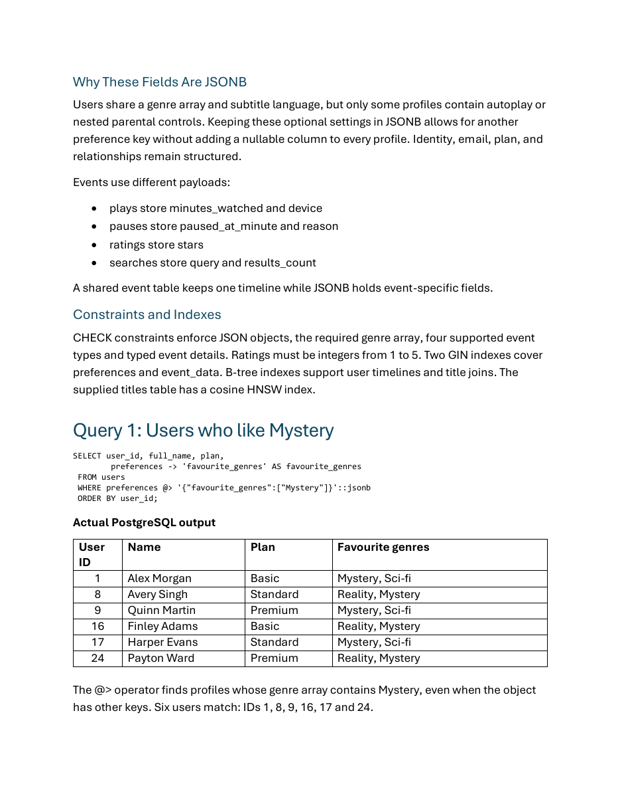
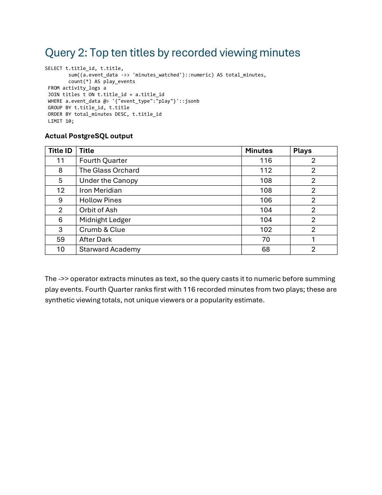
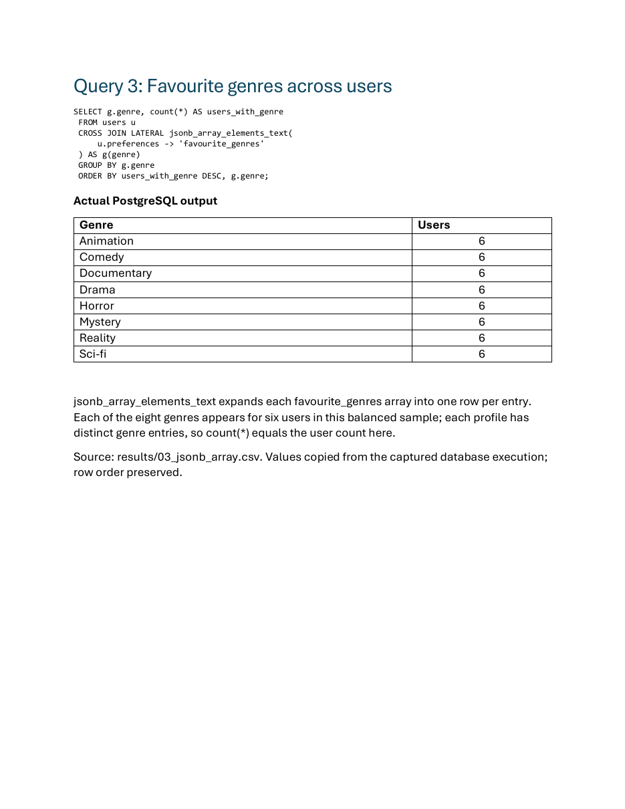
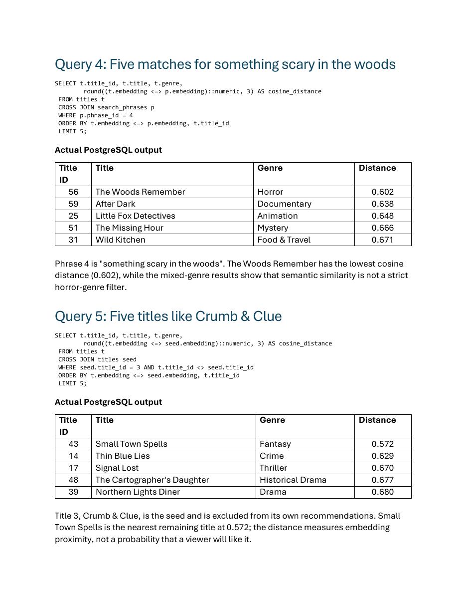
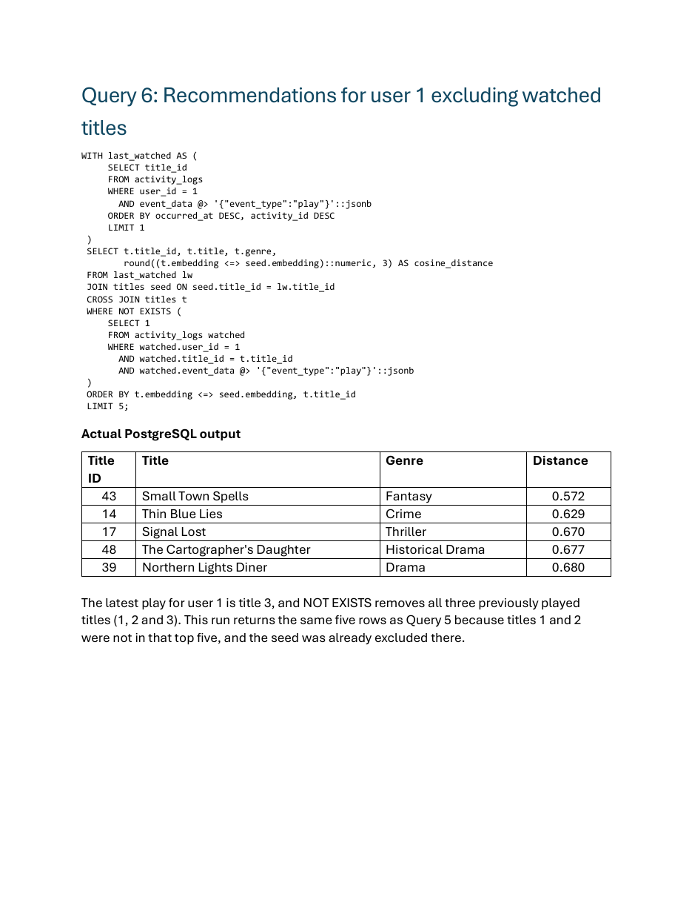

# Class Activity 3: JSONB and Vector Databases

DBAD 4000 — Group 6

Seth Garciano, Tristin Bates, Troy Franks, Yisong Wang

A streaming database using PostgreSQL 18.6 and pgvector 0.8.7. It contains 24 synthetic users, 144 activity events, 60 titles and 5 search phrases. Title and phrase embeddings have 384 dimensions and use `all-MiniLM-L6-v2`.

[Report (PDF)](report/Class%20Activity%20JSONB%20and%20Vector%20Databases%20Document.pdf) · [Database diagram (PDF)](docs/CA3_Database_Diagram.pdf) · [Editable diagram](docs/CA3_Database_Diagram.drawio)

## Files

| Folder | Contents |
| --- | --- |
| `sql/` | Schema, sample data, two generated vector SQL files, six queries and validation scripts |
| `notebooks/` | Executed instructor notebook, title CSV and Python dependencies |
| `results/` | Actual query outputs in CSV and text, execution evidence and query plans |
| `docs/` | Editable draw.io database diagram, diagram PDF and Windows pgvector setup instructions |
| `report/` | Report covering the design, six queries and results, scalability and team contributions; query page previews |
| `scripts/` | Synthetic data generator and document generation script |

## Run

1. Install PostgreSQL 18 and pgvector using [the setup instructions](docs/Windows_pgvector_Setup.txt).
2. Create a database named `ca3_streaming`.
3. Open a new pgAdmin Query Tool connected to that database and run [00_load_all_pgadmin.sql](sql/00_load_all_pgadmin.sql).
4. Run the individual files in [sql/queries](sql/queries) to view each result.

The combined script loads the schema and data, runs the six queries and checks the database. Its phrase loader replaces `search_phrases`.

Alternatively, run from the repository folder with psql:

```powershell
& 'C:\Program Files\PostgreSQL\18\bin\psql.exe' -h 127.0.0.1 -p 5432 -U postgres -d ca3_streaming -f sql/run_all.psql
```

## Data and queries

`scripts/generate_sample_data.py` creates fictional profiles and deterministic activity data: 72 plays, 24 pauses, 24 ratings and 24 searches. It writes the sample JSON files and `sql/02_sample_data.sql`.

The six queries cover JSONB containment, numeric aggregation, array expansion, phrase similarity, title similarity and recommendations excluding watched titles. [Saved results](results/query_results.txt) and [validation evidence](results/validation.json) record the successful database run.

## Query result previews

The following images are pages from the report showing the SQL and recorded PostgreSQL results.

<details>
<summary>View all six queries and results</summary>

**Query 1 — JSONB containment**



**Query 2 — Viewing minutes**



**Query 3 — Favourite genres**



**Queries 4 and 5 — Phrase and title similarity**



**Query 6 — Recommendations excluding watched titles**



</details>

The notebook and catalogue are instructor-supplied. Setup, SQL, synthetic data and documentation were prepared with Codex assistance.
